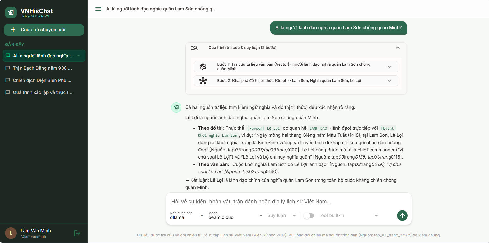
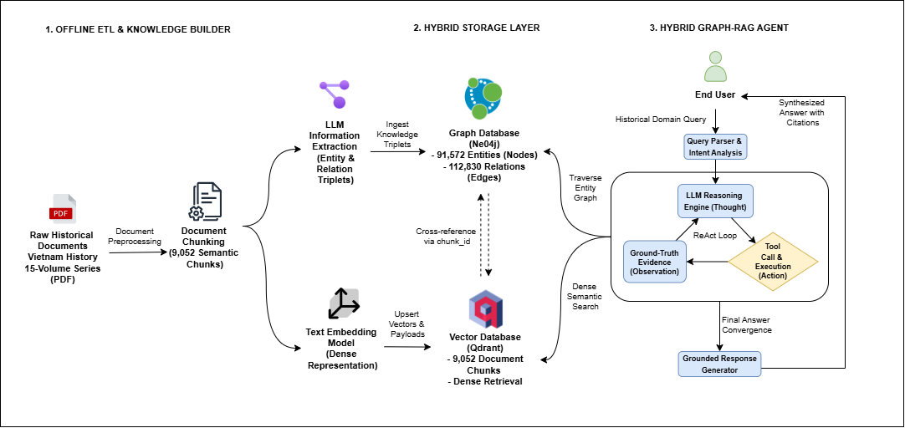
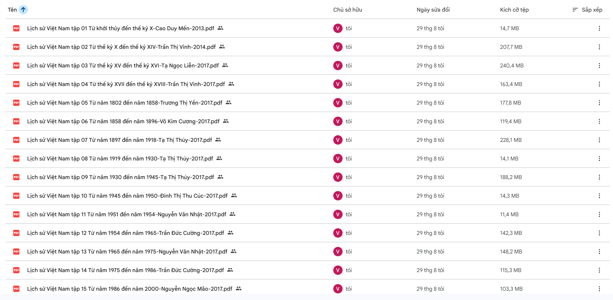
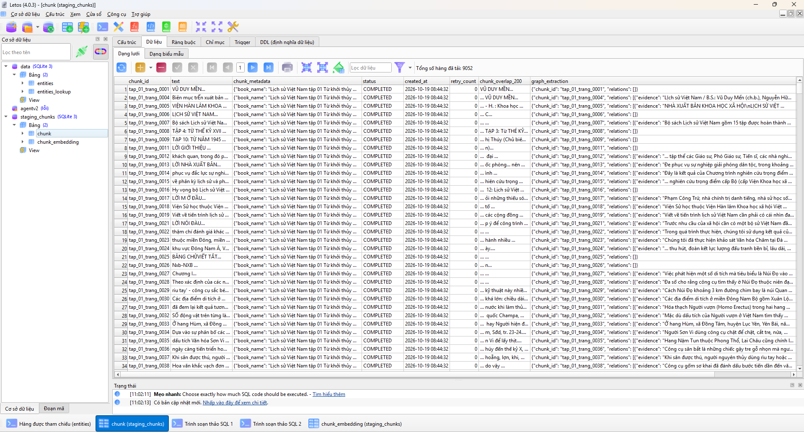
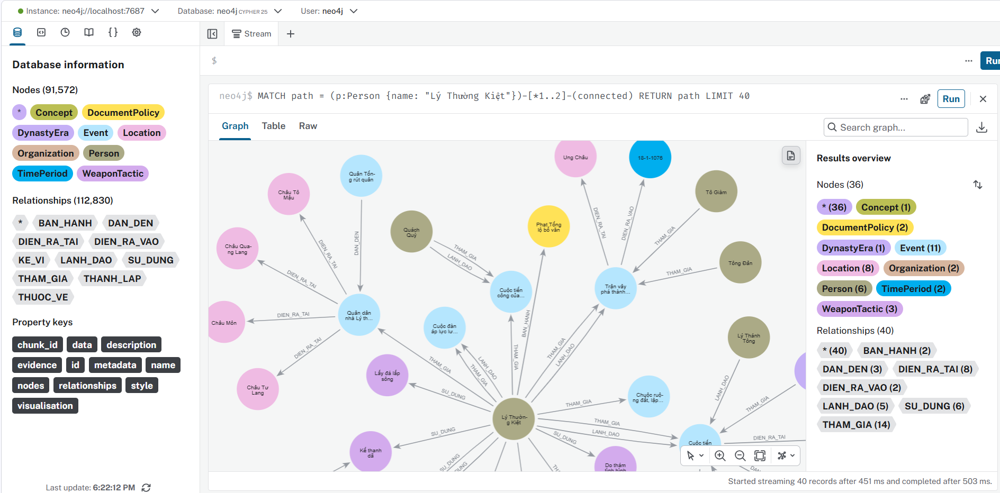
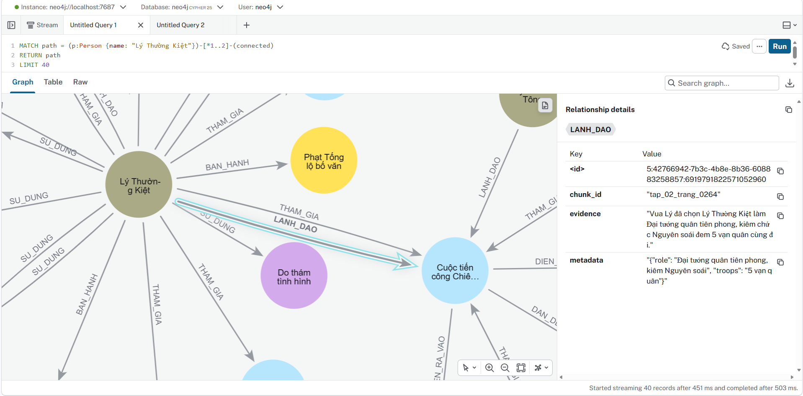

# VN History & Geography QA — Agentic Hybrid RAG System

Hệ thống trợ lý hỏi đáp chuyên sâu về Lịch sử và Địa lý Việt Nam, kết hợp cơ sở dữ liệu vector và đồ thị tri thức để cung cấp câu trả lời có trích dẫn nguồn trang sách giúp người dùng tiện đối chiếu, kiểm chứng.


<div align="center">
  
  <p><i>Hệ thống tra cứu kết hợp Vector và Đồ thị có dẫn nguồn</i></p>
</div>

## 1. Kiến trúc hệ thống

Toàn bộ quy trình từ khâu chuẩn bị dữ liệu đến khâu phục vụ hỏi đáp thông minh thời gian thực được thể hiện qua sơ đồ dưới đây:

<div align="center">
  
  <p><i>Sơ đồ kiến trúc tổng thể: Pipeline Offline ETL, Tầng lưu trữ lai (Neo4j & Qdrant) và Luồng phục vụ trực tuyến của ReAct Agent</i></p>
</div>

---

## 2. Đặc điểm kỹ thuật

- **Điều phối suy luận ReAct**: Tự động hóa quá trình phân tích câu hỏi, lựa chọn công cụ tra cứu, bắt lỗi an toàn khi thực thi và kiểm soát số bước suy luận tối đa.
- **Tìm kiếm lai kết hợp (Hybrid Retrieval)**: Kết hợp giữa tìm kiếm độ tương đồng vector trên văn bản và khai phá mạng lưới quan hệ thực thể trên đồ thị, hỗ trợ xếp hạng lại để nâng cao độ chính xác.
- **Hỗ trợ linh hoạt mô hình ngôn ngữ**: Cung cấp sẵn các bộ kết nối cho OpenAI, Groq và Ollama, dễ dàng mở rộng thêm các nhà cung cấp khác qua cổng giao tiếp chung.

---

## 3. Các công cụ truy xuất dữ liệu chính

Agent tương tác với hai nguồn dữ liệu thông qua các công cụ truy xuất được định nghĩa rõ ràng:

- **`rag_search_chunks`**: Tìm kiếm các đoạn tư liệu tương đồng ngữ nghĩa trên kho vector Qdrant, sau đó thực hiện xếp hạng lại để chọn ra các đoạn văn bản sát với câu hỏi nhất.
- **`rag_search_graph`**: Tra cứu thực thể và mở rộng các mối quan hệ liên kết trên đồ thị tri thức Neo4j, cung cấp thông tin liên quan kèm câu văn bằng chứng và mã trang nguồn.

---

## 4. Dữ liệu và hạ tầng lưu trữ

Dữ liệu của hệ thống được xây dựng từ nguồn sách lịch sử chính thống và được tổ chức trên hai cơ sở dữ liệu chuyên dụng:

### 4.1. Nguồn tài liệu và phân đoạn văn bản

Nguồn tư liệu sử dụng là công trình **Bộ 15 tập Lịch sử Việt Nam (Viện Sử học 2017)**.

<div align="center">
  
  <p><i>Nguồn tư liệu: Bộ 15 tập Lịch sử Việt Nam — Viện Sử học (2017)</i></p>
</div>

Văn bản sách được tiền xử lý và băm đoạn có cấu trúc theo từng trang sách với mã định danh dạng `tap_XX_trang_YYYY`, tạo nên **9.052 đoạn tư liệu** hoàn chỉnh.

<div align="center">
  
  <p><i>Phân đoạn văn bản thành 9.052 đoạn tư liệu có cấu trúc</i></p>
</div>

### 4.2. Kho dữ liệu vector (Qdrant)

- Lưu trữ toàn bộ **9.052 đoạn tư liệu** tại collection `vnhis`.
- Biểu diễn ngữ nghĩa bằng vector 768 chiều (mô hình `bkai-foundation-models/vietnamese-bi-encoder`, tính khoảng cách Cosine).
- Mỗi bản ghi lưu kèm mã định danh `chunk_id` cùng toàn văn trang sách để phục vụ tìm kiếm và đọc trực tiếp.

### 4.3. Đồ thị tri thức (Neo4j)

Từ các đoạn tư liệu gốc, các thực thể và mối quan hệ lịch sử được trích xuất để xây dựng đồ thị tri thức:
- **Quy mô cơ sở dữ liệu**: **91.572 thực thể** và **112.830 mối quan hệ**.
- **Cấu trúc phân loại**: Gồm 9 nhóm thực thể chính (`Person`, `Event`, `Location`, `Organization`, `DynastyEra`, `TimePeriod`, `DocumentPolicy`, `WeaponTactic`, `Concept`) và 10 loại quan hệ lịch sử (`DIEN_RA_VAO`, `THAM_GIA`, `DIEN_RA_TAI`, `DAN_DEN`, `THUOC_VE`, `BAN_HANH`, `LANH_DAO`, `THANH_LAP`, `SU_DUNG`, `KE_VI`).
- **Liên kết truy vết nguồn**: Mỗi quan hệ trên đồ thị đều lưu kèm câu văn bằng chứng (`evidence`) và mã trang nguồn (`chunk_id`), tạo liên kết trực tiếp sang kho tư liệu văn bản.

<div align="center">
  
  <p><i>Tổng quan cơ sở dữ liệu đồ thị tri thức trên Neo4j (91.572 thực thể và 112.830 quan hệ)</i></p>
</div>

<div align="center">
  
  <p><i>Chi tiết quan hệ trên đồ thị với câu văn bằng chứng và mã trang sách gốc</i></p>
</div>

### 4.4. Quy trình chuẩn bị dữ liệu

Dữ liệu phục vụ cho hệ thống được chuẩn bị thông qua hai quy trình xử lý độc lập trước khi nạp vào cơ sở dữ liệu:
- **Quy trình nhúng vector**: Thực hiện phân đoạn văn bản và chuyển đổi thành vector để nạp vào Qdrant (tham khảo tại [`text-embedding`](../text-embedding)).
- **Quy trình trích xuất đồ thị**: Sử dụng mô hình ngôn ngữ để bóc tách thực thể và quan hệ theo lược đồ định sẵn rồi nạp vào Neo4j (tham khảo tại [`text2triple`](../text2triple)).

---

## 5. Cấu trúc thư mục mã nguồn

Hệ thống được tổ chức theo các tầng chức năng rõ ràng:

```text
vn-history-geography-qa/
├── docker-compose.yaml                  # Cấu hình khởi chạy Qdrant, Neo4j, PostgreSQL, pgAdmin
├── pyproject.toml                       # Cấu hình gói và các phụ thuộc
├── .env.example                         # Mẫu cấu hình biến môi trường
└── src/
    ├── bootstrap.py                     # Khởi tạo và liên kết các thành phần hệ thống
    ├── domain/                          # Thực thể, mô hình dữ liệu và các giao diện trừu tượng (Ports)
    │   ├── entities.py                  # User, Session, Conversation, LlmModel
    │   ├── models.py                    # AgentContext, các loại Message
    │   ├── ports.py                     # Hợp đồng giao tiếp (LLMPort, Tool, LoggerPort...)
    │   └── exceptions.py                # Định nghĩa lỗi nghiệp vụ
    ├── application/                     # Các dịch vụ điều phối nghiệp vụ
    │   ├── agent_service.py             # Điều phối vòng lặp suy luận ReAct
    │   ├── rag_service.py               # Dịch vụ tìm kiếm vector và đồ thị tri thức
    │   ├── context_strategy.py          # Chiến lược quản lý cửa sổ ngữ cảnh
    │   ├── tool_service.py              # Đăng ký và quản lý công cụ
    │   └── usecases/                    # Các ca sử dụng chính của ứng dụng
    ├── infrastructure/                  # Cài đặt chi tiết các bộ kết nối bên ngoài (Adapters)
    │   ├── config.py                    # Quản lý cấu hình môi trường
    │   ├── llm/                         # Bộ kết nối mô hình ngôn ngữ (OpenAI, Groq, Ollama)
    │   ├── rag/                         # Bộ kết nối Qdrant, Neo4j, mô hình nhúng và xếp hạng lại
    │   ├── tools/knowledge/             # Cài đặt các công cụ truy xuất tri thức
    │   ├── persistence/sqlalchemy/      # Quản lý lưu trữ người dùng và hội thoại với PostgreSQL
    │   └── security/                    # Xử lý băm mật khẩu
    ├── presentation/                    # Giao diện người dùng
    │   ├── web_ui.py                    # Giao diện web hỏi đáp (NiceGUI)
    │   ├── admin_ui.py                  # Giao diện quản trị cấu hình mô hình
    │   └── cli.py                       # Giao diện dòng lệnh
    └── entries_point/                   # Điểm khởi chạy ứng dụng
        └── web_nicegui.py
```
